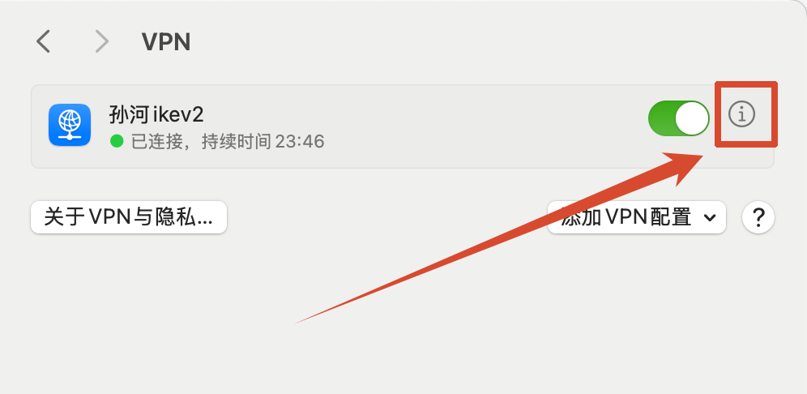
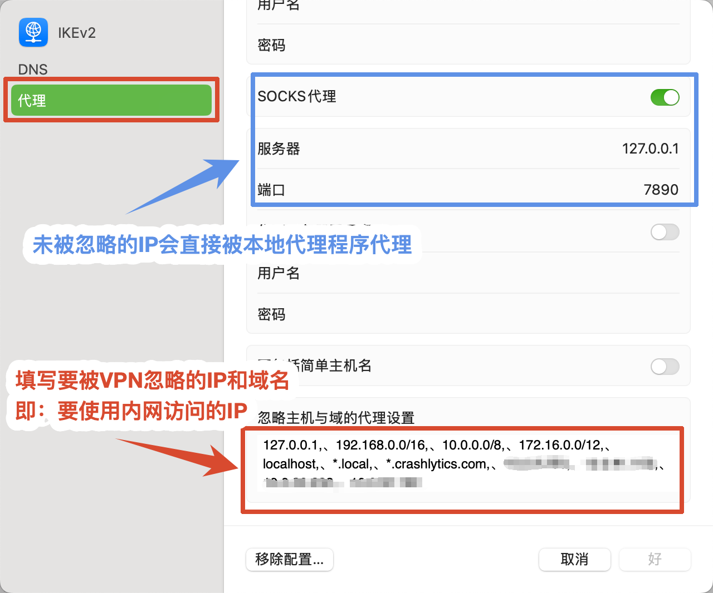
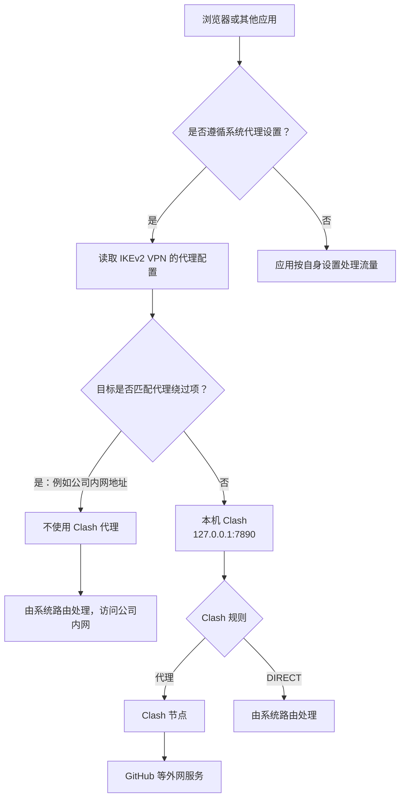

## 问题与快速解决方案

在 macOS 上使用系统自带的 IKEv2 连接公司 VPN 时，Clash Verge 原本配置的系统代理不再生效。此时在 Clash Verge 中开启「系统代理」报错：

```text
no active network service
```

我的解决办法是在**公司 IKEv2 VPN 自身的「代理」设置中**，手动指向 Clash 的本地代理端口。保持 Clash 运行，Clash Verge 的「系统代理」开关可以关闭。





**实际验证结果：** 连接公司 VPN 后，浏览器既能访问公司内网网站，也能访问 GitHub 等需要 Clash 代理的网站。整个过程无需修改公司 VPN 服务端，也没有手动修改系统路由或 DNS。

## 原理

### 为什么会出现这个问题

连接公司 VPN 之前，`scutil --proxy` 显示当前系统代理指向 Clash：

```text
HTTPProxy  : 127.0.0.1
HTTPPort   : 7890
HTTPSProxy : 127.0.0.1
HTTPSPort  : 7890
SOCKSProxy : 127.0.0.1
SOCKSPort  : 7890
```

连接 VPN 后，同一命令仅显示：

```text
<dictionary> {
  FTPPassive : 1
}
```

这说明当时系统报告的当前代理配置中不再包含 Clash。与此同时，Clash Verge 报「no active network service」，无法通过它的开关重新写入系统代理。具体为什么无法识别网络服务，未做进一步确认。

但 Clash 本身仍然可用：保持公司 VPN 连接、关闭 Clash Verge「系统代理」后，显式指定 Clash 代理请求 ChatGPT 仍获得了 HTTP 200：

```bash
curl --noproxy "" \
  -x http://127.0.0.1:7890 \
  -I -v --max-time 20 \
  https://chatgpt.com
```

这说明：**至少在该次测试中，应用只要明确使用本地 Clash 代理，Clash 仍能完成外网请求。** `-I` 请求的是响应头；HTTP 200 本身不代表所有网站或应用都已验证。

### 前提

- 公司 VPN 使用 macOS 自带的 IKEv2 配置，且该配置的「代理」页面可编辑。
- Clash Verge 正在运行，代理核心监听的端口为 `7890`。如果你的端口不同，以下设置要改成实际端口。
- 在连接 VPN 时，使用上面的 `curl` 命令明确指定代理可以成功访问外网。

### 配置步骤

1. 打开 macOS「系统设置」→「VPN」→ 对应的 IKEv2 VPN 详情 →「代理」。不同系统版本的入口名称可能略有差异。
2. 打开「网页代理（HTTP）」，服务器填 `127.0.0.1`，端口填 `7890`。
3. 打开「安全代理（HTTPS）」，服务器和端口同样填 `127.0.0.1` 和 `7890`。
4. 如果需要 SOCKS 代理，且 Clash 的 mixed 端口支持 SOCKS，也可打开「SOCKS 代理」，填相同地址和端口。本次原始系统代理配置中包含 SOCKS，但验证结果不能证明所有应用都需要它。
5. 保持「自动发现代理」和「自动配置代理」关闭，避免与手动配置混用。
6. 将原有的代理绕过项填入「忽略主机与域的代理设置」，用逗号分隔。此次原始配置中的示例如下；应根据自己的实际网络调整：

   ```text
   127.0.0.1, 192.168.0.0/16, 10.0.0.0/8, 172.16.0.0/12, localhost, *.local, *.crashlytics.com, <通过公司VPN访问的IP>...
   ```

   原配置中的 `<local>` 可通过「不包括简单主机名」选项对应处理。不同应用对 CIDR 写法的处理可能不同，仍需实测内网访问；也可按需要加入公司的内网域名。

7. 点击「好」保存。若没有立即生效，可断开并重新连接 VPN。
8. 保持 Clash Verge 运行，无须开启 Clash Verge 的「系统代理」开关。DNS 设置保持原样。

> 不要直接照搬其他环境中的内部地址。配置前建议先记录原设置，方便恢复。

### 流量是如何走的

下面的图展示这次成功配置的**逻辑关系**：支持系统代理的应用读取 VPN 配置中的代理设置，再由代理绕过列表和 Clash 规则决定后续处理。



**代理分流与 VPN 路由是两个不同层次：**

- 代理设置决定支持该设置的应用是否先把请求交给本机 Clash。
- 绕过代理不等于绕过公司 VPN；绕过代理后的连接仍由 macOS 的路由决定。
- Clash 的 `DIRECT` 也表示不使用 Clash 上游代理，实际走哪个网络接口仍取决于系统路由。
- Clash 到远端节点的连接同样受系统路由和 VPN 策略影响。
- 不遵循系统代理的应用不一定受此设置影响；VPN 断开后则由当时其他生效的网络代理配置决定行为。

因此，这个方案让两种访问在当前环境中共存，但不等同于证明公司 VPN 已配置为 IP 层面的 split tunnel。

## 验证与排查

连接 VPN 后：

1. 运行 `scutil --proxy`，检查当前 HTTP、HTTPS 代理是否指向 `127.0.0.1:7890`。SOCKS 是否出现取决于是否启用。
2. 使用浏览器访问 GitHub 等网站，并在 Clash Verge 的连接记录中确认请求进入 Clash。
3. 访问公司内网网站，确认代理绕过项和 VPN 连接正常。
4. 如果浏览器仍使用旧连接，重启浏览器后再试。
5. 如果指定本地代理的 `curl` 也失败，先确认 Clash 正在运行、端口正确，再查看 Clash 的节点连接日志。

这个配置依赖 Clash 运行：如果 Clash 停止，依赖该代理的应用可能无法访问网络。内网域名解析仍使用当前系统/VPN 的 DNS 配置，不能仅凭代理设置推断所有 DNS 请求的去向。

## 恢复原状

回到该 IKEv2 VPN 的「代理」页面，关闭本次启用的 HTTP、HTTPS、SOCKS 开关，并将绕过项及「不包括简单主机名」恢复为修改前的状态；必要时重新连接 VPN。恢复后可再次运行 `scutil --proxy` 检查当前配置。

## 参考资料

- [Apple：更改 Mac 上的代理设置](https://support.apple.com/en-gb/guide/mac-help/mchlp2591/mac)
- [Apple：VPN 连接中的代理设置](https://developer.apple.com/documentation/networkextension/nevpnprotocol/proxysettings)
- [Clash Verge Rev：代理绕过](https://www.clashverge.dev/guide/bypass.html)
- [Clash Verge Rev：活动网络服务识别失败的相关问题](https://github.com/clash-verge-rev/clash-verge-rev/issues/8083)（不同 VPN 环境的相似案例，不代表本次问题根因已确认）
